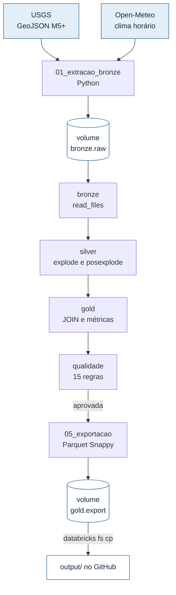
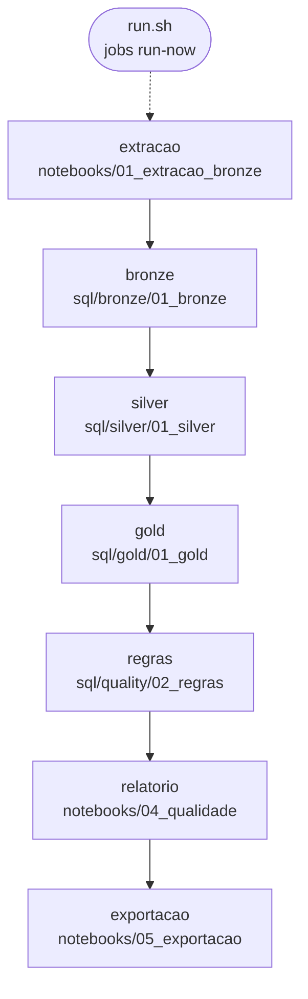
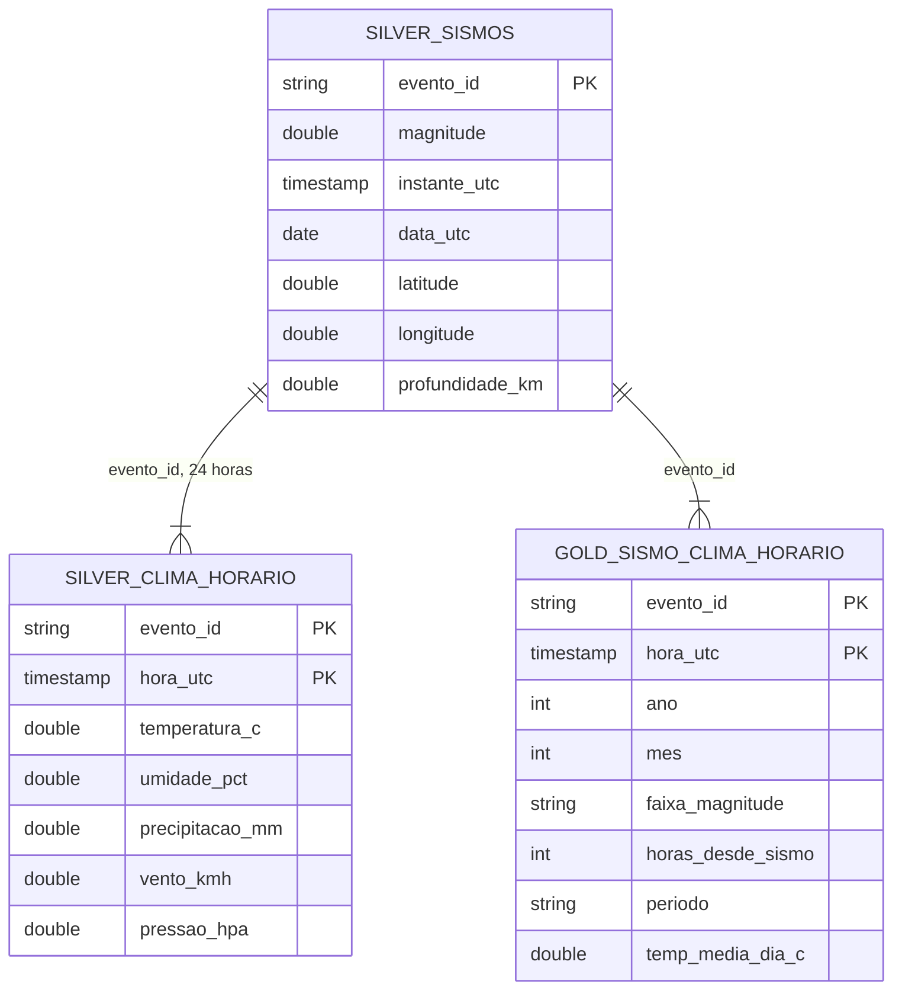

# Arquitetura da solução
Versão 0.2 · 24/11/2026 · como construído (as-built)

| Camada | Objeto (Unity Catalog) | Conteúdo | Evidência |
|---|---|---|---|
| Landing | volume `ft03_sismos_clima.bronze.raw` | JSON bruto das 2 APIs e `extracao_relatorio.json` | OB-19, OB-39 |
| Bronze | `bronze.usgs_resposta`, `bronze.meteo_resposta` | JSON lido com `read_files`, sem transformação, com `_arquivo` e `_lido_em` | OB-20, OB-21 |
| Silver | `silver.sismos`, `silver.clima_horario` | desaninhamento em SQL, tipos, nulos e deduplicação | OB-22 a OB-25 |
| Gold | `gold.sismo_clima_horario` | JOIN por `evento_id` e métricas; `PARTITIONED BY (ano, mes)`; Snappy | OB-27, OB-28 |
| Qualidade | `gold.qualidade_regras` e `gold.export/reports/quality_report.json` | schema, nulos, unicidade, intervalos, completude | OB-30 a OB-33 |
| Exportação | volume `gold.export/dataset` e `output/` no Git | Parquet Snappy particionado | OB-41, OB-43 |

Execução: Databricks Free Edition, serverless, Python e SQL. Orquestração: um job com 7 tarefas em sequência, disparado por `run.sh`.

## 1. Visão geral da solução
Das duas APIs até o Parquet no repositório. As setas mostram o caminho do dado.

## 2. Orquestração: job de 7 tarefas
Job `ft03-sismos-clima-pipeline` (`jobs/ft03_pipeline.json`). Cada tarefa só começa se a anterior terminar com sucesso.

## 3. Modelo de dados
Uma linha da gold = um sismo numa hora UTC do dia do sismo. Chave: (`evento_id`, `hora_utc`).

