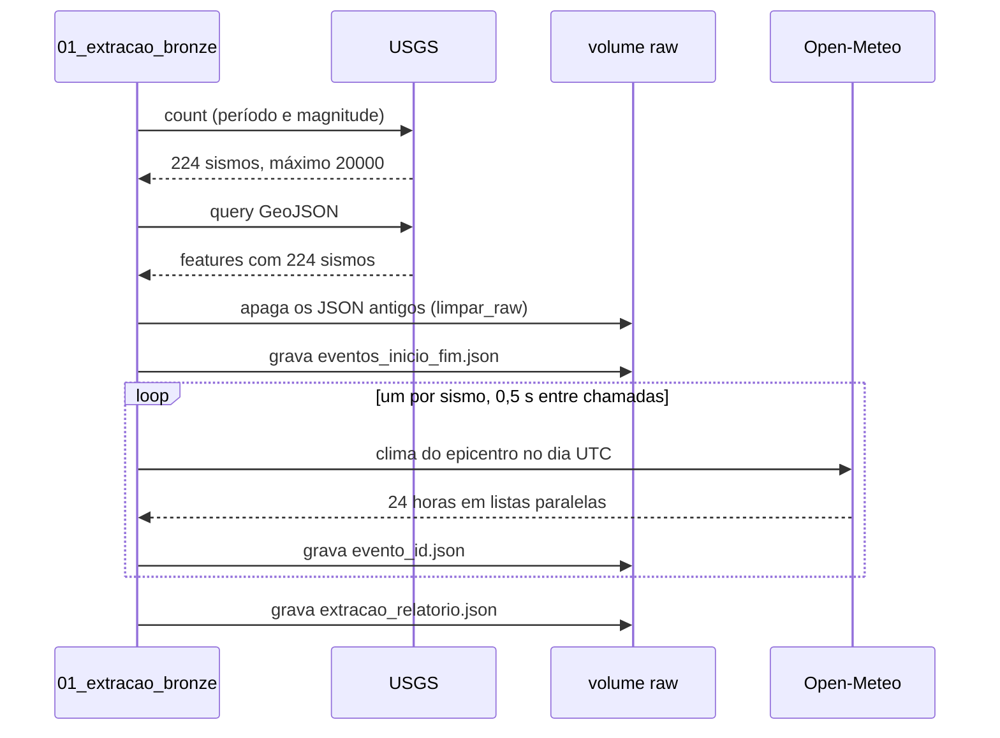
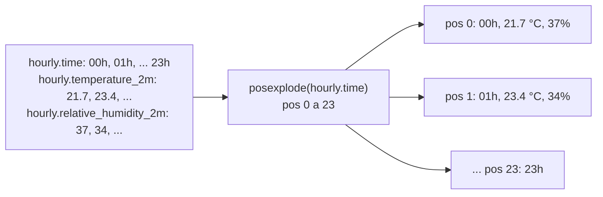
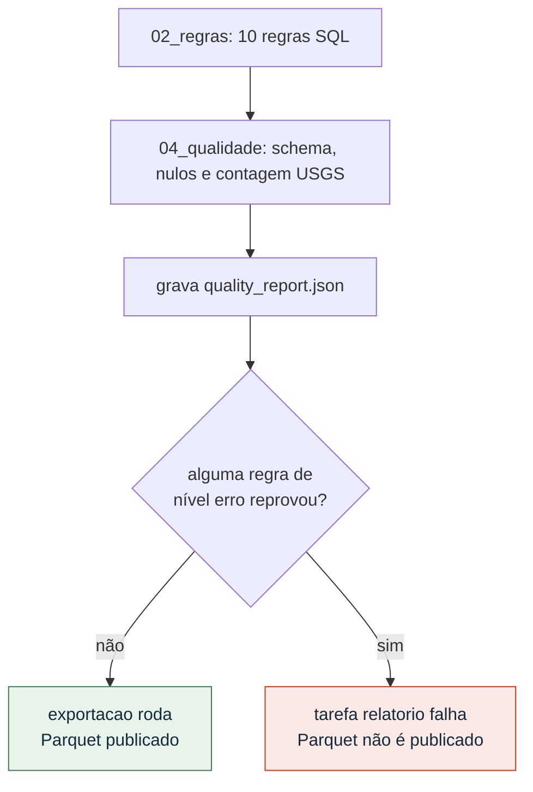
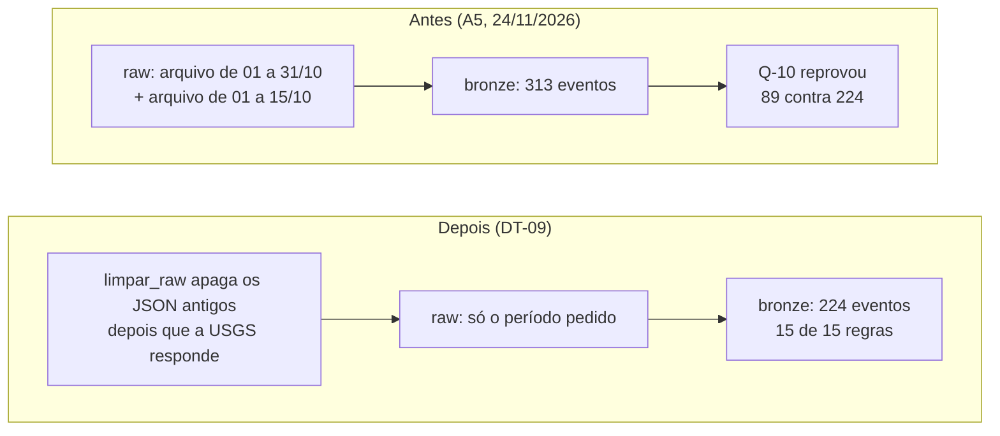

# Diagramas
Versão 0.2 · 24/11/2026

## Extração resiliente
Uma chamada `count` e uma `query` na USGS, depois uma chamada ao Open-Meteo por sismo. O cliente HTTP espera o intervalo mínimo antes de cada chamada e repete só erros transitórios (429, 5xx, timeout), respeitando `Retry-After`.

## Desaninhamento do clima em SQL
O Open-Meteo devolve uma lista por variável, todas na mesma ordem. `posexplode(hourly.time)` cria uma linha por hora e guarda a posição; a posição lê o valor de cada lista.

## Política de falha da qualidade
O relatório é gravado antes da decisão. Uma regra de nível erro reprovada derruba a tarefa `relatorio`, e a `exportacao` não roda.

## Reprocessamento sem duplicar
Lição da OB-38: antes da correção, o volume `raw` guardava o arquivo de um período anterior e a bronze lia os dois.

