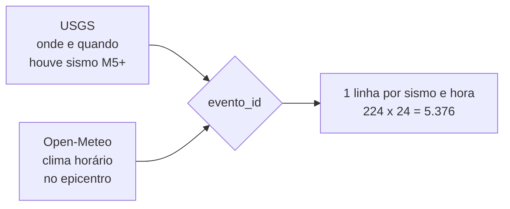
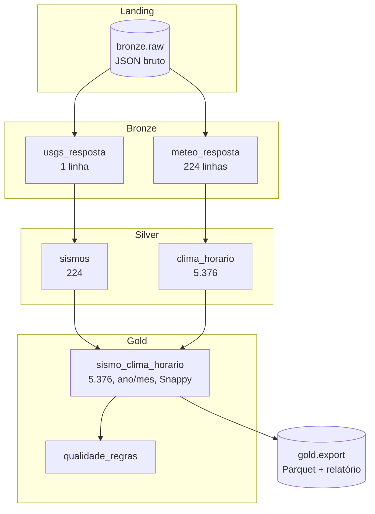
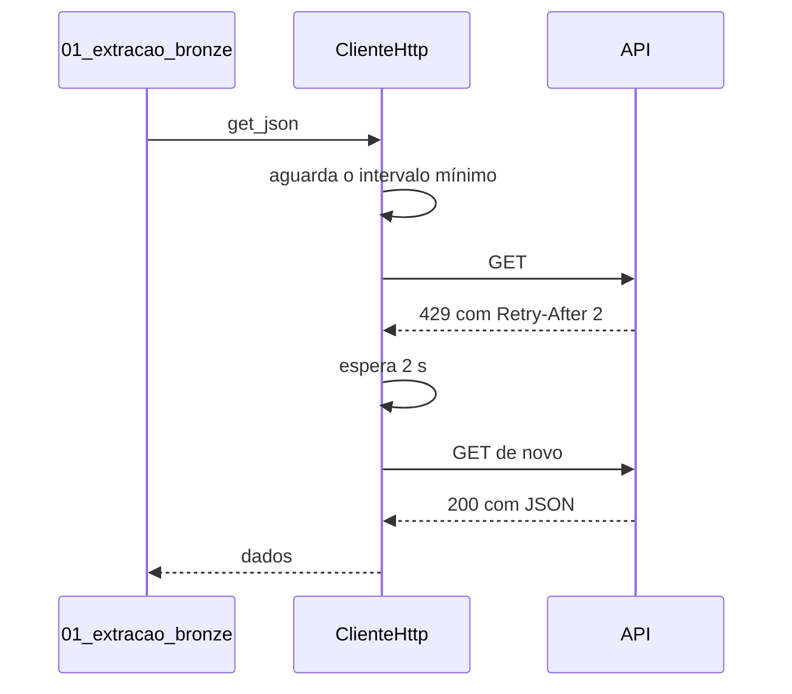
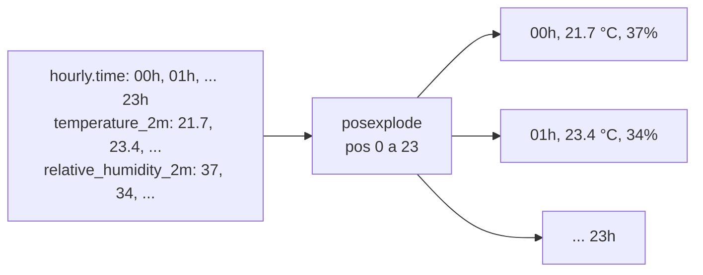
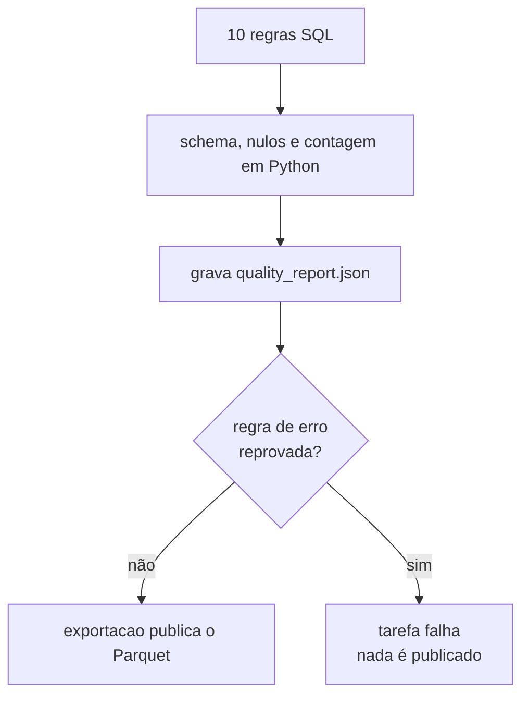
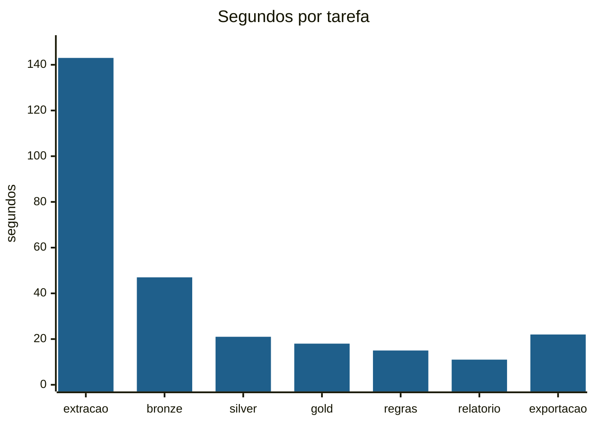
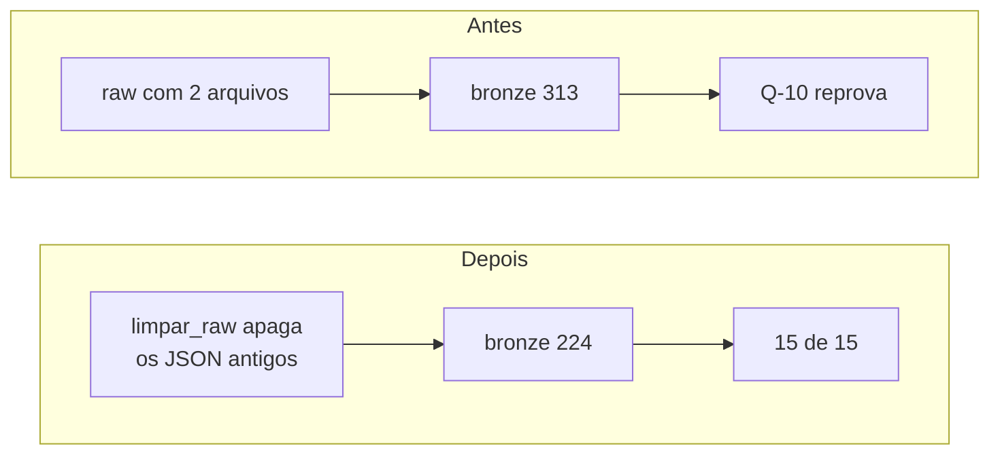

# Apresentação técnica: Sismos × Clima no Databricks
Versão 0.1 · 24/11/2026 · roteiro para a equipe técnica. Todos os números vêm das execuções registradas nas OB.

## Roteiro
| # | Parte | O que mostrar |
|---|---|---|
| 1 | O problema | Pergunta, fontes e resultado em uma frase |
| 2 | As duas APIs | Limites publicados e quantas chamadas o pipeline faz |
| 3 | Arquitetura | Medalhão no Unity Catalog e o job de 7 tarefas |
| 4 | Extração resiliente | Controle de taxa, retentativas e limpeza do `raw` |
| 5 | Bronze e silver | Desaninhamento em SQL com `explode` e `posexplode` |
| 6 | Gold | JOIN por `evento_id` e as métricas |
| 7 | Qualidade | 15 regras, teste negativo e política de falha |
| 8 | Exportação | Parquet Snappy particionado e a prova no rodapé |
| 9 | Orquestração | Job, `run.sh` e tempo de cada tarefa |
| 10 | Reprocessamento | O erro real que apareceu e a correção |
| 11 | Resultados | Números finais e requisitos |
| 12 | Demonstração ao vivo | Comandos e consultas |
| 13 | Limitações | O que ficou em aberto |

## 1. O problema
**Pergunta:** como estavam temperatura, umidade, chuva, vento e pressão no epicentro, hora a hora, no dia de cada terremoto de magnitude 5 ou mais, antes e depois do horário do sismo?

**Resultado em uma frase:** em outubro de 2026, 224 sismos cruzados com 24 horas de clima cada, numa tabela gold de 5.376 linhas, publicada em Parquet Snappy com 15 de 15 regras de qualidade aprovadas.

Fora do escopo: dizer se o clima causa sismos (não há análise de causalidade).

## 2. As duas APIs
| | USGS Earthquake Catalog | Open-Meteo Historical |
|---|---|---|
| Domínio | Sismologia | Meteorologia |
| Formato | GeoJSON, lista `features[]` | listas paralelas em `hourly` |
| Autenticação | não exige | não exige (plano gratuito) |
| Limite publicado | 20.000 eventos por consulta; taxa não publicada (429 em excesso) | 600/min, 5.000/h, 10.000/dia |
| Uso no projeto | 1 `count` + 1 `query` | 1 chamada por sismo (1 dia, 5 variáveis) |

Outubro de 2026: **226 chamadas** (OB-19), cerca de 2% do limite diário do Open-Meteo. O `count` vem antes da `query` para saber se o período cabe numa consulta só (OB-06).

## 3. Arquitetura
Medalhão no Unity Catalog, catálogo `ft03_sismos_clima`. Tudo em serverless, só Python e SQL.

Por que assim: a bronze guarda o bruto para reprocessar sem chamar as APIs de novo (R-03); cada tabela é recriada inteira, então reexecutar não duplica.

## 4. Extração resiliente
`src/sismos_clima/http_client.py` separa duas coisas: **controle de taxa** (evita o excesso) e **retentativa** (trata a falha que aconteceu mesmo assim).

| Item | Valor | Base |
|---|---|---|
| Intervalo mínimo USGS | 1 s | limite não publicado; valor conservador |
| Intervalo mínimo Open-Meteo | 0,5 s | 120 por minuto contra 600 publicados |
| Repete | 429, 500, 502, 503, 504, timeout, falha de conexão | erros transitórios |
| Não repete | 400 e demais 4xx | erro permanente (OB-16: `limit=20001` devolveu 400 sem retentativa) |
| Espera | 1, 2, 4, 8 s com até 25% de variação aleatória; obedece `Retry-After` | backoff exponencial com jitter |
| Tempo limite | 10 s para conectar, 30 s para ler | |

Teste no workspace com sessão falsa (OB-16): 429 com Retry-After 2, timeout, 503 e 200 deram 4 chamadas e esperas de 2, 2 e 4 s. Mais 8 testes unitários cobrem esses casos.

## 5. Bronze e silver: desaninhamento em SQL
A bronze lê os JSON com `read_files`, sem mudar nada. A silver abre as listas:

| Fonte | Estrutura aninhada | SQL |
|---|---|---|
| USGS | `features[]`, um item por sismo | `explode(features)` |
| Open-Meteo | `hourly.time[]` e uma lista por variável, na mesma ordem | `LATERAL VIEW posexplode(hourly.time)` + `try_element_at(lista, pos + 1)` |

Transformações na silver: **T1** tipos e datas (milissegundos para TIMESTAMP), **T2** nulos (linha sem chave, instante, magnitude ou coordenada é rejeitada; clima nulo continua nulo) e **T3** deduplicação (fica a versão mais recente de cada sismo). Valores reais do primeiro sismo (us6000tyny, OB-24): 21.7, 23.4, 23.7 °C nas primeiras horas.

## 6. Gold: JOIN e métricas
**T4** JOIN de `silver.sismos` com `silver.clima_horario` por `evento_id`. **T5** métricas.

Por que `evento_id` e não a coordenada: o Open-Meteo ajusta o ponto à grade (enviado 36.1078, 68.7436; devolvido 36.098415, 68.75486, OB-08). O id vem do nome do arquivo de clima.

| Métrica | Regra |
|---|---|
| `horas_desde_sismo` | hora do clima menos a hora cheia do sismo (-23 a 23) |
| `periodo` | `antes`, `hora do sismo` ou `depois` |
| `faixa_magnitude` | `5.0 a 5.9`, `6.0 a 6.9`, `7.0 ou mais` |
| `temp_media_dia_c`, `amplitude_termica_dia_c`, `precipitacao_total_dia_mm` | sobre as 24 horas do sismo |

Exemplo real (OB-28): sismo `aka2026tuxgky` às 18:34:31 UTC; as horas 17:00, 18:00 e 19:00 viram -1, 0 e 1 e `antes`, `hora do sismo` e `depois`.

Prova de que o JOIN não multiplicou linhas (OB-27): INNER e LEFT JOIN deram 5.376 linhas, igual a 224 x 24.

## 7. Qualidade
| Tipo | Regras |
|---|---|
| Schema | Q-01a, Q-01b, Q-01c (colunas e tipos das 3 tabelas) |
| Nulos | Q-02 (erro), Q-03 (aviso, taxa por variável) |
| Unicidade | Q-04, Q-05a, Q-05b |
| Intervalo | Q-06 magnitude, Q-07 coordenadas, Q-08 umidade e chuva |
| Completude | Q-09 24 horas, Q-10 silver igual ao `count` da USGS, Q-11 gold = sismos x 24 |
| Consistência | Q-12 hora no mesmo dia do sismo |

**Teste negativo:** zero violações nos dados reais não prova que a regra detecta defeito. As 10 regras em SQL foram aplicadas a dados inventados com defeito e todas detectaram (OB-31, OB-44).

## 8. Exportação: Parquet Snappy particionado
`05_exportacao`: `write.mode("overwrite").partitionBy("ano", "mes").option("compression", "snappy").parquet(...)`.

| Prova | Resultado (OB-41, OB-43) |
|---|---|
| Partição | `ano=2026/mes=10/` (mês sem zero à esquerda) |
| Linhas | 5.376 no Parquet, igual à gold |
| Colunas no arquivo | 20 (`ano` e `mes` ficam no nome das pastas; 22 ao ler) |
| Compressão no rodapé | `SNAPPY` em todas as colunas (lido com `pyarrow`) |
| Formato Parquet | 1.0, gravado pelo Photon |

Ponto para a equipe: o nome `.snappy.parquet` e a propriedade da tabela não provam a compressão; o rodapé do arquivo prova.

## 9. Orquestração
Job `ft03-sismos-clima-pipeline`, 7 tarefas em sequência, sem cluster configurado (serverless). Comando único: `run.sh` (`databricks jobs run-now`, espera o fim).

Ordem das tarefas: extracao, bronze, silver, gold, regras, relatorio, exportacao (cada uma só começa se a anterior terminar com sucesso).

Tempo de cada tarefa na execução 931832972977407 (281 s no total, 24/11/2026), do início ao fim da tarefa:

A extração é metade do tempo por causa do intervalo entre chamadas: 224 chamadas a 0,5 s já são cerca de 112 s.

## 10. Reprocessamento: o erro real e a correção
Teste A5 (OB-38): rodamos o job com `data_fim` = 15/10. A tarefa `relatorio` falhou de propósito: a Q-10 achou 89 sismos na USGS contra 224 na silver.

Causa: o volume `raw` guardava o arquivo do período anterior, e a bronze lia os dois (313 eventos = 224 + 89).

Correção (DT-09): `extract.limpar_raw` apaga os JSON antigos **depois** que a USGS responde, para uma falha de rede não apagar o que existe. Validado: 226 arquivos removidos e 15 de 15 regras (OB-39).

## 11. Resultados
| Indicador | Valor |
|---|---|
| Sismos M5+ em out/2026 | 224 |
| Linhas na gold | 5.376 (22 colunas) |
| Regras de qualidade | 15 de 15 aprovadas |
| Testes unitários | 34 passed (Linux e Windows) |
| Requisitos do desafio | 15 de 15 com evidência |
| Comando único | `SUCCESS` em 281 s, 7 tarefas |
| Clone limpo | `run.sh` com LF, testes e job `SUCCESS` (OB-46) |

## 12. Demonstração ao vivo
| # | O que fazer | Comando ou lugar |
|---|---|---|
| 1 | Rodar o pipeline inteiro | `& "C:\Program Files\Git\bin\bash.exe" run.sh` (cerca de 5 min) |
| 2 | Ler o resumo do relatório | `databricks fs cat "dbfs:/Volumes/ft03_sismos_clima/gold/export/reports/quality_report.json" -p ft03 \| Out-String \| ConvertFrom-Json \| Select-Object periodo, contagens, resumo, aprovado \| Format-List` |
| 3 | Ver a virada antes e depois | notebook `sql/gold/01_gold`, célula **Ver a virada antes e depois do sismo** |
| 4 | Ver o teste negativo | notebook `sql/quality/02_regras`, células de teste com dados ruins |
| 5 | Ver a prova do Snappy | notebook `notebooks/05_exportacao`, célula **Provar o Snappy no rodapé do Parquet** |
| 6 | Rodar os testes | `.venv\Scripts\python -m pytest tests` |

Dica: rodar o passo 1 no começo da apresentação, para o resultado estar pronto no passo 11.

## 13. Limitações e próximos passos
| Item | Situação |
|---|---|
| Taxa da USGS | não publicada; 1 s por chamada é escolha conservadora (DT-04) |
| Nome do catálogo nos SQL | fixo; o parâmetro só vale para os notebooks Python (DT-05) |
| Q-06 | magnitude mínima 5 fixa (DT-07) |
| `qualidade_regras` | sem horário de geração (DT-08) |
| Código de saída na falha | resolvido: o `run.sh` confere o `result_state` e sai com 1 (OB-47) |
| Open-Meteo | uso não comercial; ERA5 com 5 dias de atraso |
| Período | só outubro de 2026 testado |
